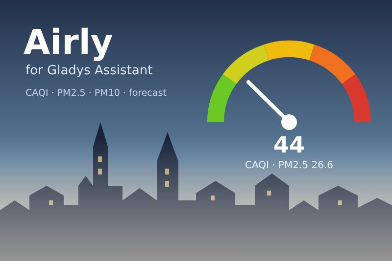
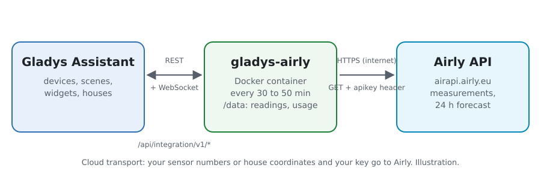
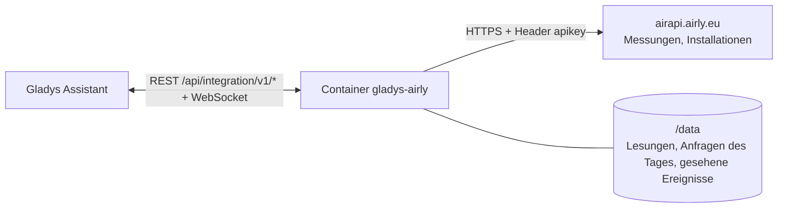
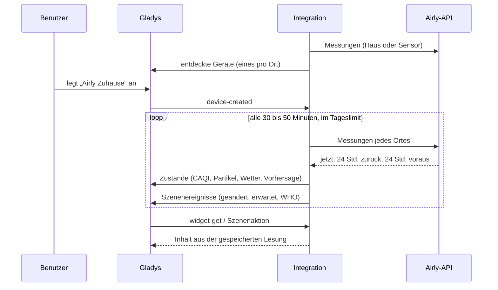
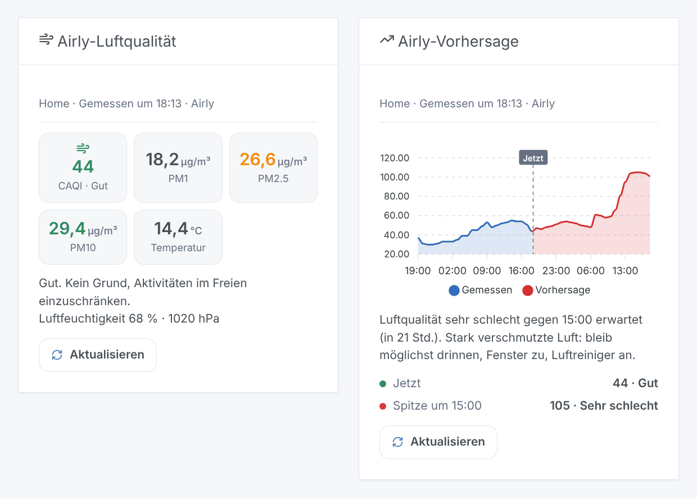

# Gladys Airly

[English](README.md) · [Français](README.fr.md) · **Deutsch** · [Español](README.es.md)

[](LICENSE)
[](https://github.com/William-De71/gladys-airly/releases)
[](https://github.com/William-De71/gladys-airly/actions/workflows/release.yml)
[](https://gladysassistant.com)



Externe Integration von [Gladys Assistant](https://gladysassistant.com) für **[Airly](https://airly.org)**, ein Netz von Luftqualitätssensoren in Polen und in Europa: der CAQI, PM1, PM2,5, PM10, das Wetter der Sensoren und die Vorhersage der nächsten 24 Stunden für deine Orte, Szenen, wenn sich die Luft verschlechtert, und Dashboard-Widgets. Sie liest die Airly-API mit einem kostenlosen Schlüssel.

## Funktionen

- **Ein Gerät pro Ort** (bis zu drei, ein Haus von Gladys oder ein Airly-Sensor): der CAQI und seine Stufe, PM2,5, PM10, der höchste erwartete CAQI in 24 Stunden sowie Temperatur, Luftfeuchtigkeit, Luftdruck, NO₂, O₃ und SO₂, wenn der Ort sie liefert.
- Ein Haus wird an seinem Standort gelesen (Airly interpoliert die umliegenden Sensoren) oder an seinem nächsten Sensor.
- **3 Szenenauslöser**, **1 Szenenaktion** und **2 Dashboard-Widgets** (siehe unten).
- Das Tageslimit des Schlüssels (100 Anfragen mit einem kostenlosen Schlüssel) verteilt die Integration selbst: jeder Ort alle 30 bis 50 Minuten, eine Reserve für den Benutzer, Lesungen in `/data` gespeichert.
- Konfigurationsknöpfe: jetzt lesen, Diagnose.
- Vier Sprachen überall: Englisch, Französisch, Deutsch, Spanisch.

## Funktionsweise





Für jeden Ort fragt die Integration `/v2/measurements/point` (ein Haus: an seinen Koordinaten interpoliert), `/v2/measurements/nearest` (ein Haus: sein nächster Sensor) oder `/v2/measurements/installation` (ein Sensor) ab. Eine Antwort enthält die aktuelle Stunde, die letzten 24 Stunden und die nächsten 24 Stunden: den CAQI, die gemessenen Werte und die WHO-Richtwerte. Die Adresse eines Sensors (`/v2/installations/{id}`) wird einmal pro Woche gelesen, um sein Gerät zu benennen. Jede Lesung wird mit der vorherigen verglichen, um die Szenenauslöser auszulösen.



### Transport

Nur Cloud (`"transports": ["cloud"]`): der Katalog zeigt das Cloud-Badge. Die Integration kontaktiert `airapi.airly.eu` über HTTPS mit deinem Schlüssel (in einem Header) und, pro Ort, der Nummer des Sensors oder den Koordinaten des Hauses (auf etwa 10 m gerundet). Es gibt keine lokale Alternative, daher keinen Knopf „Lokale Verbindung bevorzugen“.

## Geräte und Funktionen

| Funktion                                          | Kategorie / Typ                                | Hinweis                                   |
| ------------------------------------------------- | ---------------------------------------------- | ----------------------------------------- |
| Luftqualitätsindex (CAQI)                         | `airquality-sensor/aqi`                        | 0-500, die Stufe ergibt sich aus dem Wert |
| Luftqualität                                      | `text/text`                                    | sehr gut, gut, mäßig, schlecht…           |
| PM2,5, PM10                                       | `pm25-sensor`, `pm10-sensor` / `decimal`       | µg/m³                                     |
| Höchster CAQI in 24 Std.                          | `airquality-sensor/aqi`                        | die erwartete Spitze                      |
| Luftqualitätsvorhersage                           | `text/text`                                    | „Höchstwert in 24 Std.: 62, Mäßig…“       |
| Außentemperatur, Außenluftfeuchtigkeit, Luftdruck | `temperature-`, `humidity-`, `pressure-sensor` | °C, %, hPa, wenn der Ort sie liefert      |
| Stickstoffdioxid, Ozon, Schwefeldioxid            | `no2-sensor`, `o3-sensor`, `so2-sensor`        | µg/m³, wenn der Ort sie liefert           |

Ein Gerät pro Ort, `should_poll: false`. Ein Wert, den Airly nicht geliefert hat, wird nicht veröffentlicht: es wird keine 0 erfunden. Eine angebotene Funktion verschwindet nie. PM1 und CO haben in Gladys keine Kategorie: sie bleiben im Widget und in der Szenenaktion.

## Szenenauslöser, -aktionen und Widgets



**Auslöser**

- **Luftqualität geändert**: die Stufe des CAQI ändert sich. Filter: Ort, neue Stufe, Richtung (schlechter, besser).
- **Verschmutzung erwartet**: die Vorhersage der nächsten 24 Stunden erreicht eine schlechte oder sehr schlechte Stufe, einmal pro Episode. Filter: Ort, Stufe.
- **WHO-Richtwert überschritten**: PM2,5, PM10, NO₂ oder Ozon der letzten Stunde überschreitet den WHO-Richtwert. Filter: Ort, Schadstoff.

**Aktion**: die Luftqualität eines Ortes lesen (CAQI, Stufe, Partikel, Wetter, WHO-Prozente, erwartete Spitze, Satz `summary`).

**Widgets**: **Airly-Luftqualität** (CAQI, PM1, PM2,5, PM10, Temperatur, Rat) und **Airly-Vorhersage** (Diagramm der letzten und der nächsten 24 Stunden, Spitze, Warnung).

**Beispiele**

- Wenn **die Luftqualität schlecht oder sehr schlecht wird** → die Fenster schließen, den Luftreiniger einschalten.
- Wenn **Verschmutzung erwartet wird** → eine Nachricht mit der Uhrzeit der Spitze an dein Handy senden.
- Jeden Morgen um 7:00 → **die Luftqualität lesen** und den `summary` vorlesen lassen.

## Voraussetzungen

- Gladys Assistant **5.2.0** oder neuer (die Hausauswahl). Ältere Instanzen können die Integration nicht installieren.
- Ein kostenloser Airly-API-Schlüssel: lege ein Konto im [Entwicklerportal von Airly](https://developer.airly.org/en) an und kopiere den Schlüssel des kostenlosen Tarifs (siehe [docs/de.md](docs/de.md#einen-api-schlüssel-erhalten)).
- Orte, die von Airly-Sensoren abgedeckt sind (siehe die [Airly-Karte](https://airly.org/map/en/)).

## Installation

- **Aus dem Store** von Gladys (Integrationen → Externe Integrationen), mit einem Klick, sobald indexiert.
- **Über die URL des Repositorys**: `https://github.com/William-De71/gladys-airly`.
- **Entwicklermodus**: das Image lokal bauen (`docker build -t gladys-airly .`) und aus Gladys installieren.

## Konfiguration

| Feld                         | Standard    | Rolle                                                      |
| ---------------------------- | ----------- | ---------------------------------------------------------- |
| API-Schlüssel                | —           | Der Schlüssel deines Airly-Kontos (geheim).                |
| Haus (Ort 1-3)               | —           | Ein Haus von Gladys: sein Standort bestimmt den Ort.       |
| Oder eine Airly-Sensornummer | —           | Die Nummer einer Airly-Installation; Vorrang vor dem Haus. |
| Luftqualität eines Hauses    | am Haus     | Am Standort des Hauses oder der nächste Sensor.            |
| Sprache der Texte            | automatisch | Namen der Geräte und Texte der Szenen.                     |

## Verwendung

1. Gib deinen API-Schlüssel und ein bis drei Orte ein (ein Haus oder eine Sensornummer) und speichere.
2. Drücke **Jetzt lesen**, um den Schlüssel zu prüfen und den CAQI jedes Ortes zu sehen.
3. Lege im Tab **Entdecken** die Geräte „Airly …“ an.
4. Füge die Widgets **Airly-Luftqualität** und **Airly-Vorhersage** einem Dashboard hinzu und erstelle Szenen mit den obigen Auslösern.

## Entwicklung

```bash
npm install
npm test                       # node --test, nie im Netzwerk
npm run lint && npm run format:check
npx github:GladysAssistant/integration-store . --skip-image-check
scripts/build-cover.sh         # cover.jpg aus docs/assets/cover.svg
docs/illustrations/render.sh   # docs/assets/widgets.<lang>.png
node .github/scripts/release.mjs next
```

Lokal liest das SDK `GLADYS_HOST_API_URL`, `GLADYS_INTEGRATION_TOKEN` und `GLADYS_INTEGRATION_SELECTOR`; `DEBUG=gladys-integration-sdk` zeigt die Logs des SDK und prüft jeden Widget-Inhalt. Die Tests liefern echte Antworten der Airly-API v2 (`test/fixtures/`, aus den Tests der Home-Assistant-Integration [airly](https://github.com/home-assistant/core), Apache 2.0, und der Python-Bibliothek [python-airly](https://github.com/ak-ambi/python-airly), MIT). Die Regeln des Projekts stehen in [CLAUDE.md](CLAUDE.md).

## Release-Prozess


Jeder Merge auf `main` startet die CI und berechnet dann die Version aus den [Conventional Commits](https://www.conventionalcommits.org/) seit dem letzten Tag: `feat` → Minor, `fix` / `perf` → Patch, `!` oder `BREAKING CHANGE` → Major (ein Minor unter 1.0.0); `docs`, `chore`, `ci`, `test`, `style`, `refactor`, `build` allein veröffentlichen nichts. Der Changelog-Abschnitt wird erzeugt, das Tag gepusht, das Multi-Architektur-Image gebaut, dann erhält `main` den Release-Commit, das GitHub Release wird erstellt und ein letzter Job prüft das öffentliche Image, den Store-Validator und das Topic.

- Der Titel des Pull Requests wird zum Squash-Commit und dann zur Changelog-Zeile: schreibe ihn auf Englisch, für den Benutzer (`pr-title.yml` prüft ihn). Bearbeite `CHANGELOG.md` nie von Hand.
- 1.0.0 ist eine Entscheidung: Actions → Release → Run workflow mit `release-as: 1.0.0`. `dry-run` zeigt die Version und die Notizen, ohne zu veröffentlichen.
- **Geschützter Branch**: das Release pusht seinen Commit mit `GITHUB_TOKEN` auf `main`. Mit einem Ruleset, das Pull Requests oder Status-Checks auf `main` verlangt, füge GitHub Actions zu seiner Bypass-Liste hinzu (oder pushe über eine GitHub App), sonst schlägt der Veröffentlichungsjob mit Anweisungen fehl.
- Mache nach dem ersten Release das Paket `ghcr.io` öffentlich (Package settings → Change visibility), sonst kann Gladys es nicht herunterladen.

## Fehlerbehebung

Siehe [docs/de.md](docs/de.md#fehlerbehebung). Melde Probleme mit den Versionen von Gladys und der Integration und den Zeilen des Knopfs **Diagnose**.

## Mitwirken

Issues und Pull Requests sind willkommen. Führe `npm run format:check && npm run lint && npm test` aus, bevor du einen Pull Request öffnest, und lasse jede externe ID und jeden gespeicherten Schlüssel unverändert (siehe [CLAUDE.md](CLAUDE.md)).

## Sicherheit

Siehe [SECURITY.md](SECURITY.md): melde Schwachstellen vertraulich. Der API-Schlüssel ist ein Feld `secret` von Gladys, wird nur an `airapi.airly.eu` über HTTPS in einem Header gesendet, nie in einer URL und nie in die Logs geschrieben; die Integration läuft schreibgeschützt, als Benutzer ohne Root-Rechte, in ihrem Container.

## Screenshots folgen

Die Bilder oben sind Illustrationen, keine Screenshots. Echte Screenshots kommen nach `docs/assets/screenshots/` (PNG, 1280 × 800): `configuration.png`, `discovery.png`, `device.png`, `scene.png`.

## Lizenz

[Apache License 2.0](LICENSE) — siehe auch [NOTICE](NOTICE). Daten bereitgestellt von Airly; diese Integration ist nicht mit Airly verbunden. Danke an die Dokumentation und das SDK von Gladys, an Airly und an die Autoren der Home-Assistant-Integration und von python-airly, deren Tests die Antworten der API dokumentieren.
