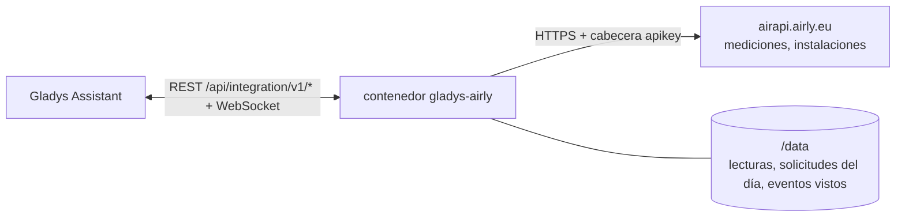
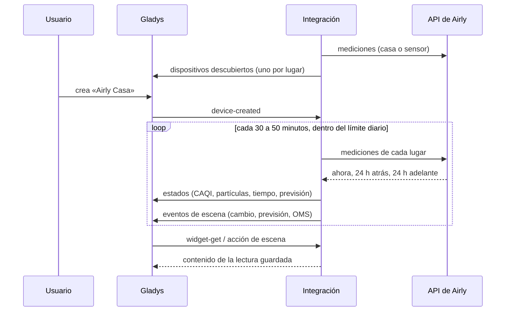
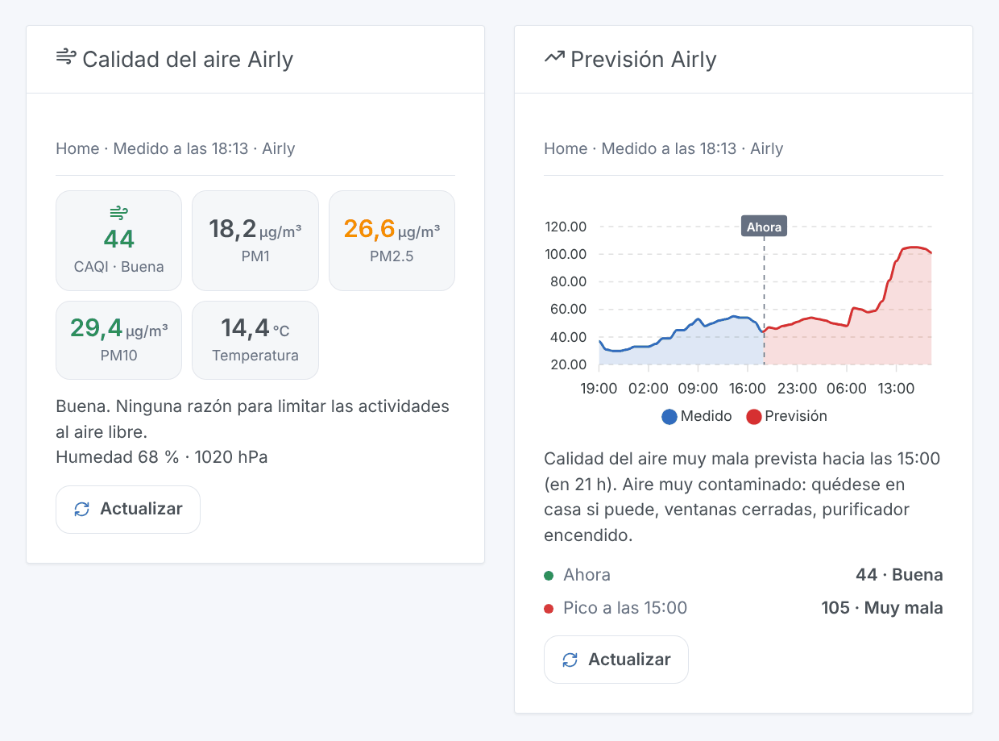

# Gladys Airly

[English](README.md) · [Français](README.fr.md) · [Deutsch](README.de.md) · **Español**

[](LICENSE)
[](https://github.com/William-De71/gladys-airly/releases)
[](https://github.com/William-De71/gladys-airly/actions/workflows/release.yml)
[](https://gladysassistant.com)


Integración externa de [Gladys Assistant](https://gladysassistant.com) para **[Airly](https://airly.org)**, una red de sensores de calidad del aire en Polonia y en Europa: el CAQI, PM1, PM2,5, PM10, el tiempo de los sensores y la previsión de las próximas 24 horas para sus lugares, escenas cuando el aire empeora, y widgets del panel. Lee la API de Airly con una clave gratuita.

## Funciones

- **Un dispositivo por lugar** (hasta tres, una casa de Gladys o un sensor Airly): el CAQI y su nivel, PM2,5, PM10, el CAQI máximo previsto en 24 horas, y la temperatura, la humedad, la presión, NO₂, O₃ y SO₂ cuando el lugar los da.
- Una casa se lee en su ubicación (Airly interpola los sensores cercanos) o en su sensor más cercano.
- **3 activadores de escena**, **1 acción de escena** y **2 widgets del panel** (más abajo).
- La integración reparte por sí misma el límite diario de la clave (100 solicitudes con una clave gratuita): cada lugar cada 30 a 50 minutos, una reserva para el usuario, lecturas guardadas en `/data`.
- Botones de configuración: leer ahora, diagnóstico.
- Cuatro idiomas en todas partes: inglés, francés, alemán, español.

## Funcionamiento




Para cada lugar, la integración consulta `/v2/measurements/point` (una casa: interpolado en sus coordenadas), `/v2/measurements/nearest` (una casa: su sensor más cercano) o `/v2/measurements/installation` (un sensor). Una respuesta contiene la hora actual, las últimas 24 horas y las próximas 24: el CAQI, los valores medidos y los valores guía de la OMS. La dirección de un sensor (`/v2/installations/{id}`) se lee una vez por semana para nombrar su dispositivo. Cada lectura se compara con la anterior para lanzar los activadores de escena.



### Transporte

Solo nube (`"transports": ["cloud"]`): el catálogo muestra la insignia de nube. La integración contacta `airapi.airly.eu` por HTTPS con su clave (en una cabecera) y, por lugar, el número del sensor o las coordenadas de la casa (redondeadas a unos 10 m). No existe alternativa local, por lo que no hay botón «Preferir la conexión local».

## Dispositivos y funciones

| Función                                        | Categoría / tipo                               | Nota                                |
| ---------------------------------------------- | ---------------------------------------------- | ----------------------------------- |
| Índice de calidad del aire (CAQI)              | `airquality-sensor/aqi`                        | 0-500, el nivel se deduce del valor |
| Calidad del aire                               | `text/text`                                    | muy buena, buena, moderada, mala…   |
| PM2,5, PM10                                    | `pm25-sensor`, `pm10-sensor` / `decimal`       | µg/m³                               |
| CAQI máximo en 24 h                            | `airquality-sensor/aqi`                        | el pico previsto                    |
| Previsión de calidad del aire                  | `text/text`                                    | «Máximo en 24 h: 62, Moderada…»     |
| Temperatura, humedad exteriores, presión       | `temperature-`, `humidity-`, `pressure-sensor` | °C, %, hPa, cuando el lugar los da  |
| Dióxido de nitrógeno, ozono, dióxido de azufre | `no2-sensor`, `o3-sensor`, `so2-sensor`        | µg/m³, cuando el lugar los da       |

Un dispositivo por lugar, `should_poll: false`. Un valor que Airly no dio no se publica: no se inventa ningún 0. Una función ofrecida nunca desaparece. PM1 y CO no tienen categoría en Gladys: quedan en el widget y en la acción de escena.

## Activadores, acciones de escena y widgets



**Activadores**

- **Cambio de calidad del aire**: el nivel del CAQI cambia. Filtros: lugar, nuevo nivel, sentido (empeora, mejora).
- **Contaminación prevista**: la previsión de las próximas 24 horas alcanza un nivel malo o muy malo, una vez por episodio. Filtros: lugar, nivel.
- **Umbral de la OMS superado**: PM2,5, PM10, NO₂ u ozono de la última hora supera el valor guía de la OMS. Filtros: lugar, contaminante.

**Acción**: leer la calidad del aire de un lugar (CAQI, nivel, partículas, tiempo, porcentajes OMS, pico previsto, frase `summary`).

**Widgets**: **Calidad del aire Airly** (CAQI, PM1, PM2,5, PM10, temperatura, consejo) y **Previsión Airly** (gráfico de las últimas y las próximas 24 horas, pico, alerta).

**Ejemplos**

- Cuando **la calidad del aire se vuelve mala o muy mala** → cerrar las ventanas, encender el purificador de aire.
- Cuando **se prevé contaminación** → enviar un mensaje a su teléfono con la hora del pico.
- Cada mañana a las 7:00 → **leer la calidad del aire** y hacer decir el `summary`.

## Requisitos

- Gladys Assistant **5.2.0** o posterior (el selector de casa). Las instancias más antiguas no pueden instalar la integración.
- Una clave de API de Airly gratuita: cree una cuenta en el [portal para desarrolladores de Airly](https://developer.airly.org/en) y copie la clave del plan gratuito (ver [docs/es.md](docs/es.md#obtener-una-clave-de-api)).
- Lugares cubiertos por sensores Airly (ver el [mapa de Airly](https://airly.org/map/en/)).

## Instalación

- **Desde la tienda** de Gladys (Integraciones → Integraciones externas), en un clic, una vez indexada.
- **Desde la URL del repositorio**: `https://github.com/William-De71/gladys-airly`.
- **Modo desarrollador**: construya la imagen localmente (`docker build -t gladys-airly .`) e instálela desde Gladys.

## Configuración

| Campo                        | Por defecto | Función                                                      |
| ---------------------------- | ----------- | ------------------------------------------------------------ |
| Clave de API                 | —           | La clave de su cuenta Airly (secreta).                       |
| Casa (lugar 1-3)             | —           | Una casa de Gladys: su ubicación sitúa el lugar.             |
| O un número de sensor Airly  | —           | El número de una instalación Airly; prevalece sobre la casa. |
| Calidad del aire de una casa | en la casa  | En la ubicación de la casa, o el sensor más cercano.         |
| Idioma de los textos         | automático  | Nombres de los dispositivos y textos de las escenas.         |

## Uso

1. Introduzca su clave de API y de uno a tres lugares (una casa o un número de sensor), y guarde.
2. Pulse **Leer ahora** para comprobar la clave y ver el CAQI de cada lugar.
3. En la pestaña **Descubrir**, cree los dispositivos «Airly …».
4. Añada los widgets **Calidad del aire Airly** y **Previsión Airly** a un panel, y cree escenas con los activadores de arriba.

## Desarrollo

```bash
npm install
npm test                       # node --test, nunca toca la red
npm run lint && npm run format:check
npx github:GladysAssistant/integration-store . --skip-image-check
scripts/build-cover.sh         # cover.jpg desde docs/assets/cover.svg
docs/illustrations/render.sh   # docs/assets/widgets.<lang>.png
node .github/scripts/release.mjs next
```

En local, el SDK lee `GLADYS_HOST_API_URL`, `GLADYS_INTEGRATION_TOKEN` y `GLADYS_INTEGRATION_SELECTOR`; `DEBUG=gladys-integration-sdk` muestra los registros del SDK y comprueba cada contenido de widget. Las pruebas sirven respuestas reales de la API de Airly v2 (`test/fixtures/`, de las pruebas de la integración de Home Assistant [airly](https://github.com/home-assistant/core), Apache 2.0, y de la biblioteca Python [python-airly](https://github.com/ak-ambi/python-airly), MIT). Las reglas del proyecto están en [CLAUDE.md](CLAUDE.md).

## Proceso de publicación


Cada fusión en `main` lanza la CI y luego calcula la versión a partir de los [Conventional Commits](https://www.conventionalcommits.org/) desde la última etiqueta: `feat` → menor, `fix` / `perf` → parche, `!` o `BREAKING CHANGE` → mayor (una menor por debajo de 1.0.0); `docs`, `chore`, `ci`, `test`, `style`, `refactor`, `build` solos no publican nada. Se genera la sección del changelog, se sube la etiqueta, se construye la imagen multiarquitectura, luego `main` recibe el commit de publicación, se crea la GitHub Release y un último job comprueba la imagen pública, el validador de la tienda y el topic.

- El título de la pull request se convierte en el commit squash y luego en la línea del changelog: escríbalo en inglés, para el usuario (`pr-title.yml` lo comprueba). Nunca edite `CHANGELOG.md` a mano.
- 1.0.0 es una decisión: Actions → Release → Run workflow con `release-as: 1.0.0`. `dry-run` muestra la versión y las notas sin publicar.
- **Rama protegida**: la publicación sube su commit a `main` con `GITHUB_TOKEN`. Con un ruleset que exija pull requests o status checks en `main`, añada GitHub Actions a su lista de omisión (o suba mediante una GitHub App); si no, el job de publicación falla con instrucciones.
- Tras la primera publicación, haga público el paquete `ghcr.io` (Package settings → Change visibility); si no, Gladys no puede descargarlo.

## Solución de problemas

Ver [docs/es.md](docs/es.md#solución-de-problemas). Informe de los problemas con las versiones de Gladys y de la integración, y las líneas del botón **Diagnóstico**.

## Contribuir

Las incidencias y las pull requests son bienvenidas. Ejecute `npm run format:check && npm run lint && npm test` antes de abrir una pull request, y mantenga sin cambios cada identificador externo y cada clave guardada (ver [CLAUDE.md](CLAUDE.md)).

## Seguridad

Ver [SECURITY.md](SECURITY.md): informe de las vulnerabilidades en privado. La clave de API es un campo `secret` de Gladys, enviada solo a `airapi.airly.eu` por HTTPS en una cabecera, nunca en una URL ni escrita en los registros; la integración se ejecuta en solo lectura, con un usuario no root, en su contenedor.

## Capturas pendientes

Las imágenes de arriba son ilustraciones, no capturas de pantalla. Las capturas reales irán en `docs/assets/screenshots/` (PNG, 1280 × 800): `configuration.png`, `discovery.png`, `device.png`, `scene.png`.

## Licencia

[Apache License 2.0](LICENSE) — ver también [NOTICE](NOTICE). Datos proporcionados por Airly; esta integración no está afiliada a Airly. Gracias a la documentación y al SDK de Gladys, a Airly, y a los autores de la integración de Home Assistant y de python-airly, cuyas pruebas documentan las respuestas de la API.
