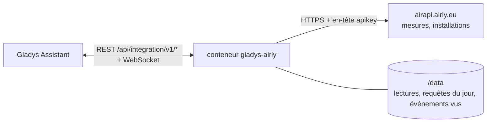
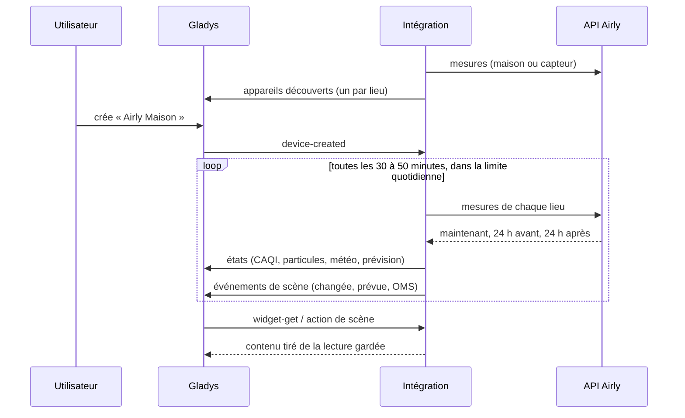
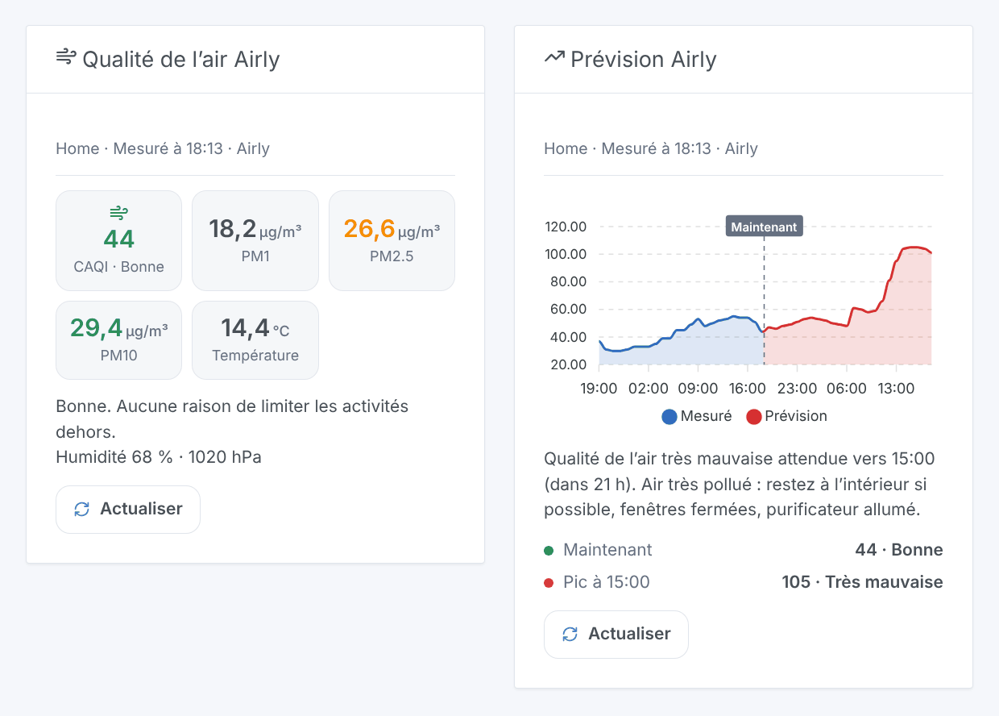

# Gladys Airly

[English](README.md) · **Français** · [Deutsch](README.de.md) · [Español](README.es.md)

[](LICENSE)
[](https://github.com/William-De71/gladys-airly/releases)
[](https://github.com/William-De71/gladys-airly/actions/workflows/release.yml)
[](https://gladysassistant.com)


Intégration externe de [Gladys Assistant](https://gladysassistant.com) pour **[Airly](https://airly.org)**, un réseau de capteurs de qualité de l’air en Pologne et en Europe : le CAQI, PM1, PM2,5, PM10, la météo des capteurs et la prévision des 24 prochaines heures pour vos lieux, des scènes quand l’air se dégrade, et des widgets de tableau de bord. Elle lit l’API Airly avec une clé gratuite.

## Fonctionnalités

- **Un appareil par lieu** (trois au plus, une maison de Gladys ou un capteur Airly) : le CAQI et son niveau, PM2,5, PM10, le CAQI maximal prévu sous 24 heures, et la température, l’humidité, la pression, NO₂, O₃ et SO₂ quand le lieu les donne.
- Une maison est lue à sa position (Airly interpole les capteurs voisins) ou à son capteur le plus proche.
- **3 déclencheurs de scène**, **1 action de scène** et **2 widgets de tableau de bord** (ci-dessous).
- La limite quotidienne de la clé (100 requêtes avec une clé gratuite) est répartie par l’intégration elle-même : chaque lieu toutes les 30 à 50 minutes, une réserve pour l’utilisateur, des lectures gardées dans `/data`.
- Boutons de configuration : lire maintenant, diagnostic.
- Quatre langues partout : anglais, français, allemand, espagnol.

## Fonctionnement




Pour chaque lieu, l’intégration interroge `/v2/measurements/point` (une maison : interpolé à ses coordonnées), `/v2/measurements/nearest` (une maison : son capteur le plus proche) ou `/v2/measurements/installation` (un capteur). Une réponse contient l’heure actuelle, les 24 dernières heures et les 24 prochaines : le CAQI, les valeurs mesurées et les valeurs guides de l’OMS. L’adresse d’un capteur (`/v2/installations/{id}`) est lue une fois par semaine pour nommer son appareil. Chaque lecture est comparée à la précédente pour déclencher les scènes.



### Transport

Cloud uniquement (`"transports": ["cloud"]`) : le catalogue affiche le badge cloud. L’intégration contacte `airapi.airly.eu` en HTTPS avec votre clé (dans un en-tête) et, pour chaque lieu, le numéro du capteur ou les coordonnées de la maison (arrondies à environ 10 m). Il n’existe pas d’alternative locale, donc pas de bouton « Préférer la connexion locale ».

## Appareils et fonctionnalités

| Fonctionnalité                              | Catégorie / type                               | Remarque                              |
| ------------------------------------------- | ---------------------------------------------- | ------------------------------------- |
| Indice de qualité de l’air (CAQI)           | `airquality-sensor/aqi`                        | 0-500, le niveau vient de la valeur   |
| Qualité de l’air                            | `text/text`                                    | très bonne, bonne, moyenne, mauvaise… |
| PM2,5, PM10                                 | `pm25-sensor`, `pm10-sensor` / `decimal`       | µg/m³                                 |
| CAQI maximal sous 24 h                      | `airquality-sensor/aqi`                        | le pic prévu                          |
| Prévision de qualité de l’air               | `text/text`                                    | « Maximum sous 24 h : 62, Moyenne… »  |
| Température, humidité extérieures, pression | `temperature-`, `humidity-`, `pressure-sensor` | °C, %, hPa, quand le lieu les donne   |
| Dioxyde d’azote, ozone, dioxyde de soufre   | `no2-sensor`, `o3-sensor`, `so2-sensor`        | µg/m³, quand le lieu les donne        |

Un appareil par lieu, `should_poll: false`. Une valeur qu’Airly n’a pas donnée n’est pas publiée : aucun 0 n’est inventé. Une fonctionnalité proposée ne disparaît jamais. PM1 et CO n’ont pas de catégorie dans Gladys : ils restent dans le widget et l’action de scène.

## Déclencheurs, actions de scène et widgets



**Déclencheurs**

- **Qualité de l’air changée** : le niveau du CAQI change. Filtres : lieu, nouveau niveau, sens (dégradation, amélioration).
- **Pollution prévue** : la prévision des 24 prochaines heures atteint un niveau mauvais ou très mauvais, une fois par épisode. Filtres : lieu, niveau.
- **Seuil OMS dépassé** : PM2,5, PM10, NO₂ ou ozone de la dernière heure dépasse la valeur guide de l’OMS. Filtres : lieu, polluant.

**Action** : lire la qualité de l’air d’un lieu (CAQI, niveau, particules, météo, pourcentages OMS, pic prévu, phrase `summary`).

**Widgets** : **Qualité de l’air Airly** (CAQI, PM1, PM2,5, PM10, température, conseil) et **Prévision Airly** (graphique des 24 dernières et des 24 prochaines heures, pic, alerte).

**Exemples**

- Quand **la qualité de l’air devient mauvaise ou très mauvaise** → fermer les fenêtres, allumer le purificateur d’air.
- Quand **une pollution est prévue** → envoyer un message sur votre téléphone avec l’heure du pic.
- Chaque matin à 7 h → **lire la qualité de l’air** et faire dire le `summary`.

## Prérequis

- Gladys Assistant **5.2.0** ou plus récent (le sélecteur de maison). Les instances plus anciennes ne peuvent pas installer l’intégration.
- Une clé d’API Airly gratuite : créez un compte sur le [portail développeur d’Airly](https://developer.airly.org/en) et copiez la clé de l’offre gratuite (voir [docs/fr.md](docs/fr.md#obtenir-une-clé-dapi)).
- Des lieux couverts par des capteurs Airly (voir la [carte Airly](https://airly.org/map/en/)).

## Installation

- **Depuis le store** de Gladys (Intégrations → Intégrations externes), en un clic, une fois indexée.
- **Depuis l’URL du dépôt** : `https://github.com/William-De71/gladys-airly`.
- **Mode développeur** : construisez l’image localement (`docker build -t gladys-airly .`) et installez-la depuis Gladys.

## Configuration

| Champ                         | Défaut      | Rôle                                                          |
| ----------------------------- | ----------- | ------------------------------------------------------------- |
| Clé d’API                     | —           | La clé de votre compte Airly (secret).                        |
| Maison (lieu 1-3)             | —           | Une maison de Gladys : sa position situe le lieu.             |
| Ou un numéro de capteur Airly | —           | Le numéro d’une installation Airly ; l’emporte sur la maison. |
| Qualité de l’air d’une maison | à la maison | À la position de la maison, ou le capteur le plus proche.     |
| Langue des textes             | automatique | Noms des appareils et textes des scènes.                      |

## Utilisation

1. Saisissez votre clé d’API et un à trois lieux (une maison ou un numéro de capteur), puis enregistrez.
2. Appuyez sur **Lire maintenant** pour vérifier la clé et voir le CAQI de chaque lieu.
3. Dans l’onglet **Découverte**, créez les appareils « Airly … ».
4. Ajoutez les widgets **Qualité de l’air Airly** et **Prévision Airly** à un tableau de bord, et créez des scènes avec les déclencheurs ci-dessus.

## Développement

```bash
npm install
npm test                       # node --test, ne touche jamais le réseau
npm run lint && npm run format:check
npx github:GladysAssistant/integration-store . --skip-image-check
scripts/build-cover.sh         # cover.jpg depuis docs/assets/cover.svg
docs/illustrations/render.sh   # docs/assets/widgets.<lang>.png
node .github/scripts/release.mjs next
```

En local, le SDK lit `GLADYS_HOST_API_URL`, `GLADYS_INTEGRATION_TOKEN` et `GLADYS_INTEGRATION_SELECTOR` ; `DEBUG=gladys-integration-sdk` affiche les journaux du SDK et vérifie chaque contenu de widget. Les tests servent de vraies réponses de l’API Airly v2 (`test/fixtures/`, issues des tests de l’intégration Home Assistant [airly](https://github.com/home-assistant/core), Apache 2.0, et de la bibliothèque Python [python-airly](https://github.com/ak-ambi/python-airly), MIT). Les règles du projet sont dans [CLAUDE.md](CLAUDE.md).

## Processus de release


Chaque fusion sur `main` lance la CI, puis calcule la version à partir des [Conventional Commits](https://www.conventionalcommits.org/) depuis le dernier tag : `feat` → mineure, `fix` / `perf` → correctif, `!` ou `BREAKING CHANGE` → majeure (une mineure sous 1.0.0) ; `docs`, `chore`, `ci`, `test`, `style`, `refactor`, `build` seuls ne publient rien. La section du changelog est générée, le tag poussé, l’image multi-architecture construite, puis `main` reçoit le commit de release, la GitHub Release est créée et un dernier job vérifie l’image publique, le validateur du store et le topic.

- Le titre de la pull request devient le commit squash, puis la ligne du changelog : écrivez-le en anglais, pour l’utilisateur (`pr-title.yml` le vérifie). Ne modifiez jamais `CHANGELOG.md` à la main.
- 1.0.0 est une décision : Actions → Release → Run workflow avec `release-as: 1.0.0`. `dry-run` montre la version et les notes sans publier.
- **Branche protégée** : la release pousse son commit sur `main` avec `GITHUB_TOKEN`. Avec un ruleset qui exige des pull requests ou des status checks sur `main`, ajoutez GitHub Actions à sa liste de contournement (ou poussez via une GitHub App), sinon le job de publication échoue avec des instructions.
- Après la première release, rendez public le package `ghcr.io` (Package settings → Change visibility), sinon Gladys ne peut pas le télécharger.

## Dépannage

Voir [docs/fr.md](docs/fr.md#dépannage). Signalez les problèmes avec les versions de Gladys et de l’intégration, et les lignes du bouton **Diagnostic**.

## Contribuer

Les issues et pull requests sont les bienvenues. Lancez `npm run format:check && npm run lint && npm test` avant d’ouvrir une pull request, et gardez inchangés chaque identifiant externe et chaque clé enregistrée (voir [CLAUDE.md](CLAUDE.md)).

## Sécurité

Voir [SECURITY.md](SECURITY.md) : signalez les vulnérabilités en privé. La clé d’API est un champ `secret` de Gladys, envoyée seulement à `airapi.airly.eu` en HTTPS dans un en-tête, jamais dans une URL ni écrite dans les journaux ; l’intégration tourne en lecture seule, avec un utilisateur non root, dans son conteneur.

## Captures à venir

Les images ci-dessus sont des illustrations, pas des captures d’écran. Les vraies captures iront dans `docs/assets/screenshots/` (PNG, 1280 × 800) : `configuration.png`, `discovery.png`, `device.png`, `scene.png`.

## Licence

[Apache License 2.0](LICENSE) — voir aussi [NOTICE](NOTICE). Données fournies par Airly ; cette intégration n’est pas affiliée à Airly. Merci à la documentation et au SDK de Gladys, à Airly, et aux auteurs de l’intégration Home Assistant et de python-airly, dont les tests documentent les réponses de l’API.
