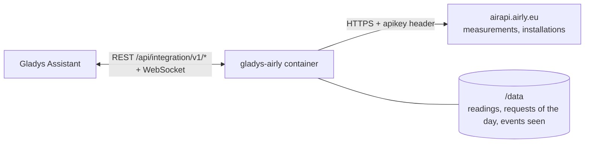
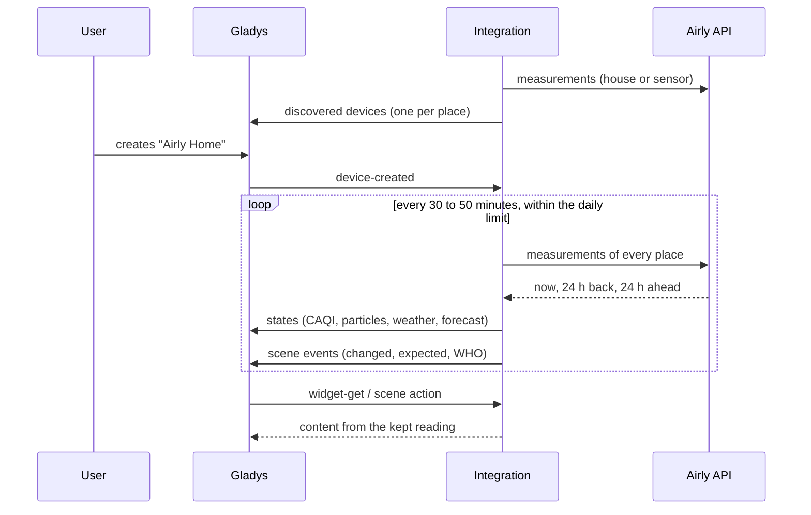
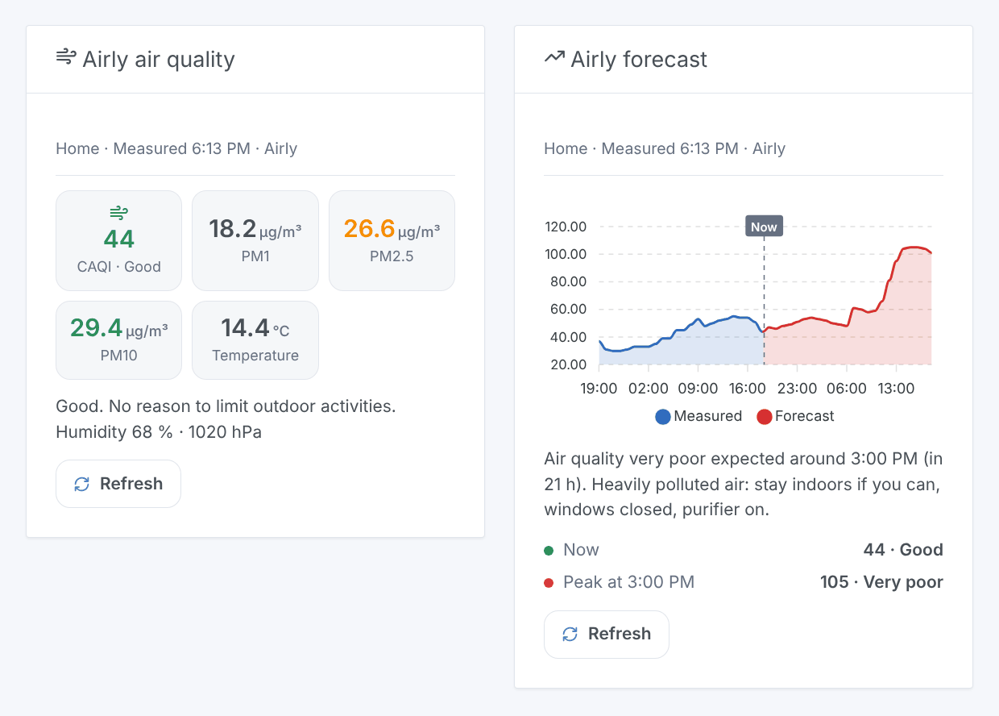

# Gladys Airly

**English** · [Français](README.fr.md) · [Deutsch](README.de.md) · [Español](README.es.md)

[](LICENSE)
[](https://github.com/William-De71/gladys-airly/releases)
[](https://github.com/William-De71/gladys-airly/actions/workflows/release.yml)
[](https://gladysassistant.com)


[Gladys Assistant](https://gladysassistant.com) external integration for **[Airly](https://airly.org)**, a network of air quality sensors in Poland and across Europe: the CAQI, PM1, PM2.5, PM10, the weather of the sensors and the forecast of the next 24 hours for your places, scenes when the air gets worse, and dashboard widgets. It reads the Airly API with a free key.

## Features

- **One device per place** (up to three, a house of Gladys or an Airly sensor): the CAQI and its level, PM2.5, PM10, the highest CAQI expected within 24 hours, and the temperature, humidity, pressure, NO₂, O₃ and SO₂ when the place gives them.
- A house is read at its location (Airly interpolates the sensors around it) or at its nearest sensor.
- **3 scene triggers**, **1 scene action** and **2 dashboard widgets** (below).
- The daily limit of the key (100 requests with a free key) is shared by the integration itself: every place every 30 to 50 minutes, a reserve for the user, readings kept in `/data`.
- Configuration buttons: read now, diagnostic.
- Four languages everywhere: English, French, German, Spanish.

## How it works




For each place, the integration asks `/v2/measurements/point` (a house: interpolated at its coordinates), `/v2/measurements/nearest` (a house: its nearest sensor) or `/v2/measurements/installation` (a sensor). One answer holds the hour now, the last 24 hours and the next 24 hours: the CAQI, the values measured and the WHO guideline values. The address of a sensor (`/v2/installations/{id}`) is read once a week to name its device. Each reading is compared with the previous one to fire the scene triggers.



### Transport

Cloud only (`"transports": ["cloud"]`): the catalog shows the cloud badge. The integration contacts `airapi.airly.eu` over HTTPS with your key (in a header) and, per place, the number of the sensor or the coordinates of the house (rounded to about 10 m). There is no local alternative, so there is no "prefer the local connection" button.

## Devices and features

| Feature                                 | Category / type                                | Note                                  |
| --------------------------------------- | ---------------------------------------------- | ------------------------------------- |
| Air quality index (CAQI)                | `airquality-sensor/aqi`                        | 0-500, the level comes from the value |
| Air quality                             | `text/text`                                    | very good, good, moderate, poor…      |
| PM2.5, PM10                             | `pm25-sensor`, `pm10-sensor` / `decimal`       | µg/m³                                 |
| Highest CAQI within 24 h                | `airquality-sensor/aqi`                        | the forecast peak                     |
| Air quality forecast                    | `text/text`                                    | "Highest within 24 h: 62, Moderate…"  |
| Outdoor temperature, humidity, pressure | `temperature-`, `humidity-`, `pressure-sensor` | °C, %, hPa, when the place gives them |
| Nitrogen dioxide, ozone, sulfur dioxide | `no2-sensor`, `o3-sensor`, `so2-sensor`        | µg/m³, when the place gives them      |

One device per place, `should_poll: false`. A value Airly did not give is not published: no 0 is invented. A feature, once offered, never goes away. PM1 and CO have no category in Gladys: they stay in the widget and the scene action.

## Scene triggers, actions and widgets



**Triggers**

- **Air quality changed**: the CAQI level changes. Filters: place, new level, direction (worse, better).
- **Pollution expected**: the forecast of the next 24 hours reaches a poor or very poor level, once per episode. Filters: place, level.
- **WHO guideline exceeded**: PM2.5, PM10, NO₂ or ozone of the last hour goes over the WHO guideline value. Filters: place, pollutant.

**Action**: read the air quality of a place (CAQI, level, particles, weather, WHO percentages, forecast peak, `summary` sentence).

**Widgets**: **Airly air quality** (CAQI, PM1, PM2.5, PM10, temperature, advice) and **Airly forecast** (chart of the last and next 24 hours, peak, warning).

**Examples**

- When **the air quality becomes poor or very poor** → close the windows, turn the air purifier on.
- When **pollution is expected** → send a message to your phone with the time of the peak.
- Every morning at 7:00 → **read the air quality** and have the `summary` spoken.

## Requirements

- Gladys Assistant **5.2.0** or later (the house picker). Older instances cannot install the integration.
- A free Airly API key: create an account on the [Airly developer portal](https://developer.airly.org/en) and copy the key of the free plan (see [docs/en.md](docs/en.md#get-an-api-key)).
- Places covered by Airly sensors (see the [Airly map](https://airly.org/map/en/)).

## Installation

- **From the store** of Gladys (Integrations → External integrations), in one click, once indexed.
- **From the repository URL**: `https://github.com/William-De71/gladys-airly`.
- **Developer mode**: build the image locally (`docker build -t gladys-airly .`) and install it from Gladys.

## Configuration

| Field                     | Default      | Role                                                      |
| ------------------------- | ------------ | --------------------------------------------------------- |
| API key                   | —            | The key of your Airly account (secret).                   |
| House (place 1-3)         | —            | A house of Gladys: its location locates the place.        |
| Or an Airly sensor number | —            | The number of an Airly installation; wins over the house. |
| Air quality of a house    | at the house | At the location of the house, or the nearest sensor.      |
| Language of the texts     | automatic    | Device names and scene texts.                             |

## Usage

1. Enter your API key and one to three places (a house or a sensor number), then save.
2. Press **Read now** to check the key and see the CAQI of each place.
3. In the **Discover** tab, create the "Airly …" devices.
4. Add the **Airly air quality** and **Airly forecast** widgets to a dashboard, and build scenes with the triggers above.

## Development

```bash
npm install
npm test                       # node --test, never touches the network
npm run lint && npm run format:check
npx github:GladysAssistant/integration-store . --skip-image-check
scripts/build-cover.sh         # cover.jpg from docs/assets/cover.svg
docs/illustrations/render.sh   # docs/assets/widgets.<lang>.png
node .github/scripts/release.mjs next
```

Locally, the SDK reads `GLADYS_HOST_API_URL`, `GLADYS_INTEGRATION_TOKEN` and `GLADYS_INTEGRATION_SELECTOR`; `DEBUG=gladys-integration-sdk` shows the SDK logs and checks every widget content. The tests serve real answers of the Airly API v2 (`test/fixtures/`, from the tests of the Home Assistant integration [airly](https://github.com/home-assistant/core), Apache 2.0, and of the Python library [python-airly](https://github.com/ak-ambi/python-airly), MIT). The rules of the project are in [CLAUDE.md](CLAUDE.md).

## Release process


Every merge on `main` runs the CI, then computes the version from the [Conventional Commits](https://www.conventionalcommits.org/) since the last tag: `feat` → minor, `fix` / `perf` → patch, `!` or `BREAKING CHANGE` → major (a minor below 1.0.0); `docs`, `chore`, `ci`, `test`, `style`, `refactor`, `build` alone publish nothing. The changelog section is generated, the tag pushed, the multi-architecture image built, then `main` receives the release commit, the GitHub Release is created and a last job checks the public image, the store validator and the topic.

- The pull request title becomes the squash commit, then the changelog line: write it in English, for the user (`pr-title.yml` checks it). Never edit `CHANGELOG.md` by hand.
- 1.0.0 is a decision: Actions → Release → Run workflow with `release-as: 1.0.0`. `dry-run` shows the version and the notes without publishing.
- **Protected branch**: the release pushes its commit to `main` with `GITHUB_TOKEN`. With a ruleset requiring pull requests or status checks on `main`, add GitHub Actions to its bypass list (or push through a GitHub App), otherwise the publish job fails with instructions.
- After the first release, make the `ghcr.io` package public (Package settings → Change visibility), or Gladys cannot pull it.

## Troubleshooting

See [docs/en.md](docs/en.md#troubleshooting). Report issues with the versions of Gladys and of the integration, and the lines of the **Diagnostic** button.

## Contributing

Issues and pull requests are welcome. Run `npm run format:check && npm run lint && npm test` before opening a pull request, and keep every external id and stored key unchanged (see [CLAUDE.md](CLAUDE.md)).

## Security

See [SECURITY.md](SECURITY.md): report vulnerabilities privately. The API key is a `secret` field of Gladys, sent only to `airapi.airly.eu` over HTTPS in a header, never in a URL and never written to the logs; the integration runs read-only, as a non-root user, in its container.

## Screenshots to come

The images above are illustrations, not screenshots. Real screenshots will go in `docs/assets/screenshots/` (PNG, 1280 × 800): `configuration.png`, `discovery.png`, `device.png`, `scene.png`.

## License

[Apache License 2.0](LICENSE) — see also [NOTICE](NOTICE). Data provided by Airly; this integration is not affiliated with Airly. Thanks to the Gladys documentation and SDK, to Airly, and to the authors of the Home Assistant integration and of python-airly, whose tests document the answers of the API.
